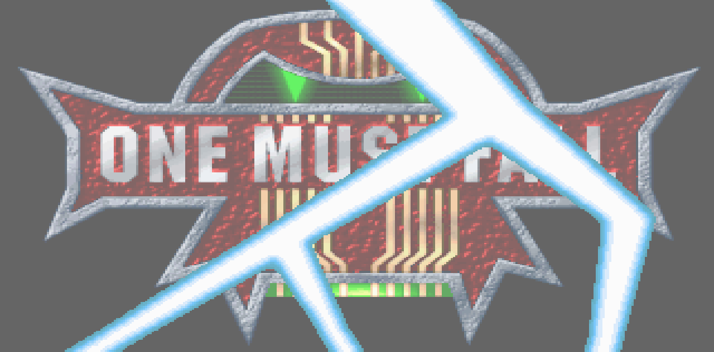

<div align="center">

# ONE MUST FALL 2097

### Il classico picchiaduro di robot del 1994, che si avvia nel tuo browser

[English](README.md) · **Italiano**


[](https://mich-de.github.io/omf2097/)

**▶ [Giocalo subito nel browser → mich-de.github.io/omf2097](https://mich-de.github.io/omf2097/)**



*Desktop e mobile, un'unica pagina: parte da sola e riempie lo schermo.*

</div>

---

## Gioca online

Nessuna installazione: apri **https://mich-de.github.io/omf2097/**, scegli **Regular Game** e attendi il download di circa 15 MB.

- **Desktop:** il gioco riempie la finestra. Frecce per muoverti, `Invio` per il pugno, `Shift destro` per il calcio, `Esc` per il menu. `F11` per lo schermo intero vero.
- **Telefono e tablet:** compaiono una croce direzionale e i tasti **PUNCH**, **KICK** ed **ESC**. All'avvio del gioco viene chiesto lo schermo intero in orizzontale dove il browser lo consente (Android sì, iPhone no).

One Must Fall 2097 è freeware dal 1999. Questo repo è anche il sito: GitHub Pages lo serve direttamente dalla radice.

## Avvio rapido

```bash
git clone https://github.com/mich-de/omf2097.git
cd omf2097
python3 -m http.server 8734
```

Apri **http://127.0.0.1:8734/** e scegli **Regular Game**. Aggiungi `?touch=1` all'indirizzo per provare i comandi mobile da computer. `npm install` serve solo per gli strumenti Node qui sotto.

## In evidenza

- **Una pagina per desktop e mobile.** Sugli schermi touch compaiono croce e pulsanti; con la tastiera funziona e basta.
- **Un launcher fatto con la grafica del gioco.** Sfondo, scritte e pannelli vengono dalle schermate NetArena del 1994 incluse nel gioco.
- **Impostazioni ottimizzate.** Velocità di gioco al 50%, audio Gravis Ultrasound stereo, CPU emulata al massimo.
- **Kit di test headless.** Avvia programmi DOS da Node, invia tasti, cattura ogni frame nuovo, modifica i file in memoria, pilota Chrome vero tramite il DevTools Protocol.

## Come è tornato in vita

1. **Lo schermo nero che non era colpa del gioco.** Nei test headless si vedeva uno schermo nero e milioni di errori CPU di divisione per zero. Il vero colpevole: `fs.readFileSync` di Node restituisce i file piccoli come viste su un pool di memoria condiviso, e l'emulatore copiava l'intero pool sul disco DOS. 40 file su 98 arrivavano come lo stesso blocco da 65.600 byte, quindi `OMF.EXE` eseguiva in realtà i byte di altri file. La soluzione: dare all'emulatore una copia `Uint8Array` propria di ogni file. `probe_fs.js` ora lo controlla prima di ogni test.
2. **"Please run SETUP.EXE".** Con i file integri il gioco partiva e si chiudeva subito. Il driver SoundBlaster `MDRV004R.MUS` preso dall'installer non conteneva le impostazioni della scheda. Sostituirlo con una copia già configurata (porta 220, IRQ 7, DMA 1) ha risolto.
3. **Dentro il launcher.** [REA](https://github.com/morluto/rea) con Ghidra 12.1.4 ha decompilato `OMF.EXE`, un launcher Turbo Pascal a 16 bit. Non contiene istruzioni di divisione che possano fallire in quel punto, e questo ha spostato l'indagine dal codice ai byte effettivamente caricati.
4. **Da Node a un browser vero.** `cdp_shot.js` pilota Chrome headless tramite il DevTools Protocol con il `WebSocket` integrato in Node, senza Puppeteer: carica la pagina, clicca, aspetta, fa lo screenshot.
5. **16:9 fatto bene.** `4/3` mantiene le proporzioni originali con bande nere ai lati. `16/9` riempie la finestra solo se è esattamente 16:9. `Fit` riempie sempre. Gli sfondi delle arene sono immagini fisse renderizzate nel 1994, quindi ai lati non c'è altro campo visivo da scoprire; per lo stesso motivo un remake del motore come OpenOMF non mostrerebbe più arena.
6. **Un launcher nello stile del gioco.** La pagina usa `NETMEGA.PCX` come sfondo, disegna le scritte pixel per pixel con il font bitmap `NETFONT1.PCX` e i colori originali, e costruisce i pannelli informativi sulla griglia blu di `NETSET.PCX`. Resta visibile durante il testo di avvio di DOS e lascia il posto al gioco quando questo passa in grafica.
7. **Comandi touch che parlano la lingua del gioco.** Croce e pulsanti inviano esattamente i tasti assegnati al giocatore 1 in `SETUP.CFG`: frecce più le diagonali del tastierino, `Invio` per il pugno, `Shift destro` per il calcio. Sugli schermi touch il gioco resta in 4:3, così i comandi stanno nelle bande laterali.
8. **Impostazioni al meglio.** La velocità di gioco ora è al 50% di default (byte 0 di `SETUP.CFG`; al 100% era troppo veloce). L'audio è passato da un Sound Blaster mono che distorceva alla Gravis Ultrasound stereo, configurata con il `SETUP.EXE` originale del gioco. L'emulatore gira con `cycles=max`.

## Screenshot

| | |
|:---:|:---:|
| <br>Launcher su desktop | <br>Telefono: croce e pulsanti durante un combattimento |
| <br>Schermata del titolo, avvio headless in Node | <br>Player js-dos in Chrome |
| <br>`renderAspect: "4/3"`: bande laterali, nessuna distorsione | <br>`renderAspect: "16/9"`: immagine stirata |
| <br>`renderAspect: "Fit"`: riempie sempre | |

## Impostazioni di gioco

| Impostazione | Valore | Dove |
|---|---|---|
| Velocità di gioco | 50% | Byte 0 di `SETUP.CFG` (`game_speed`, 0-10) |
| Audio | Gravis Ultrasound, stereo (240 / IRQ 5 / DMA 3) | `SOUNDCRD.INF`, `MDRV003R.MUS`, `gus=true` in `dosbox.conf` |
| CPU emulata | `cycles=max` | `dosbox.conf` e `jsdos.json` nel bundle |
| Video | Ombre alte, animazioni, animazione della palette e scosse dello schermo attive | Valori predefiniti del gioco, già al massimo |

## Cosa c'è nel repo

| Percorso | Cos'è |
|---|---|
| `index.html` | La pagina di gioco: launcher, player js-dos, comandi touch |
| `js-dos/` | Player js-dos 8.5 e build WebAssembly di DOSBox-X servita con la pagina |
| `assets/` | Grafica del launcher presa dal gioco (sfondo `NETMEGA.PCX`, logo) |
| `omf2097.jsdos` | Bundle pronto da avviare: file del gioco più configurazione DOSBox |
| `installed_game/` | Gioco installato e configurato |
| `extracted/` | Contenuto originale del CD: installer e manuali |
| `omf_clean_test/`, `*.zip`, `*.iso` | Archivi di origine e una copia preinstallata di riferimento |
| `browser_test.html` | Pagina di test minima usata durante lo sviluppo (richiede `npm install`) |
| `probe.js` | Esecuzione DOSBox headless: cattura dei frame, invio tasti, modifiche ai file in memoria |
| `probe_fs.js` | Controlla che l'emulatore veda i file identici byte per byte |
| `cdp_shot.js` | Pilota Chrome via CDP: carica, aspetta, clicca, fa lo screenshot, valuta espressioni |
| `test_*.js`, `run_setup_gen.js` | Esperimenti precedenti di installazione e setup |

## Strumenti

```bash
npm install

# L'emulatore vede i file integri?
node probe_fs.js installed_game

# Avvia qualcosa in headless e salva ogni frame nuovo in screenshots/
node probe.js dosbox "OMF.EXE" 30 mytag
# variabili: DIR=  BUNDLE=<file.jsdos>  KEYS="sec:keycode,..."  STEP_MS=
#            OVERRIDE="FILE=path"  EXCLUDE="FILE,..."  PATCH="FILE@offset:hexbytes"

# Screenshot della pagina in Chrome vero
google-chrome-stable --headless=new --remote-debugging-port=9333 --remote-allow-origins='*' --window-size=1280,720 about:blank &
node cdp_shot.js "http://127.0.0.1:8734/" 20000 out.png [x,y] [waitAfterClickMs]
```

## Opzioni di visualizzazione

`index.html` passa queste opzioni a `Dos()` di js-dos v8:

| Opzione | Valore | Effetto |
|---|---|---|
| `autoStart` | `true` | Si avvia appena scegli **Regular Game**, senza tasto play |
| `kiosk` | `true` | Nasconde la barra laterale di js-dos |
| `renderAspect` | `"Fit"` su desktop, `"4/3"` su touch | Su desktop riempie la finestra; sugli schermi touch il 4:3 lascia le bande laterali ai comandi |
| modalità touch | `(pointer: coarse)` | Rilevata in automatico; `?touch=1` la forza attiva, `?touch=0` spenta |

Altri valori di `renderAspect`: `"AsIs"`, `"16/9"`, `"16/10"`, `"5/4"`, `"1/1"`.
