<div align="center">

# ONE MUST FALL 2097

### The 1994 robot fighting classic, booting in your browser

**English** · [Italiano](README.it.md)


[](https://mich-de.github.io/omf2097/)

**▶ [Play it now in your browser → mich-de.github.io/omf2097](https://mich-de.github.io/omf2097/)**

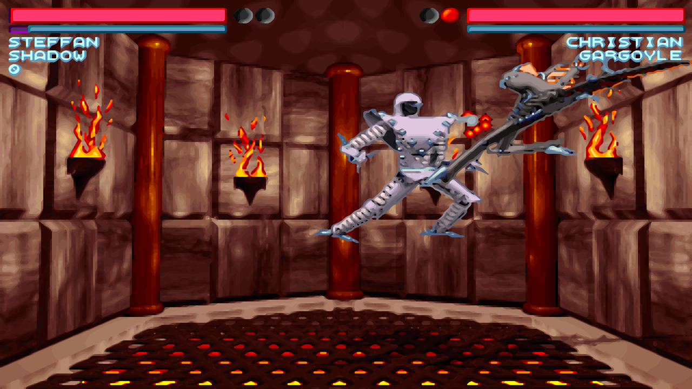

*Shadow vs Gargoyle in the Fire Pit: full window on desktop, xBR filter on.*

</div>

---

## Play online

No install needed: open **https://mich-de.github.io/omf2097/**, pick **Regular Game** and wait for the ~15 MB download.

- **Desktop:** the game fills the window. Arrow keys to move, `Enter` to punch, `Right Shift` to kick, `Esc` for the menu. Move the mouse to show the full screen and filter buttons (top left), or press `F11`.
- **Phone and tablet:** an on-screen pad appears with **PUNCH**, **KICK**, **ESC**, a full screen button and the filter button. Starting the game asks for landscape full screen where the browser allows it (Android does, iPhone doesn't).
- **Picture:** phones and tablets smooth the pixel art with xBR by default; on desktop the filter starts off. `F9` or the filter button cycles **OFF** (the raw pixels), **XBR** and **CRT** (scanlines, like a 1994 monitor), and the page remembers your choice.
- **Nova:** on the robot selection screen of a one-player game, a **+ NOVA** tile (desktop, or press `N`) or a **PLAY WITH NOVA** button above KICK (phone) appears. The page performs the original cheat for you and picks Nova, with any of the ten pilots. In a two-player game player 2 still has to do the cheat by hand.
- **Leaving:** pick **QUIT** in the game's main menu (`Esc` jumps to it) and the page goes back to the start screen.

One Must Fall 2097 has been freeware since 1999. This repo is also the site: GitHub Pages serves it straight from the root.

## Gameplay

| | |
|:---:|:---:|
| 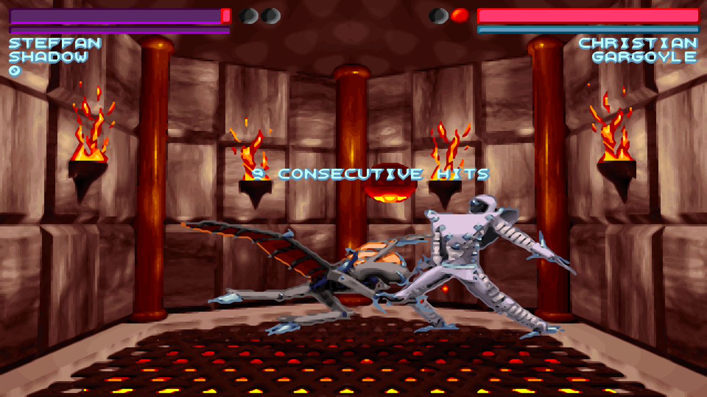<br>Consecutive hits in the Fire Pit, xBR | 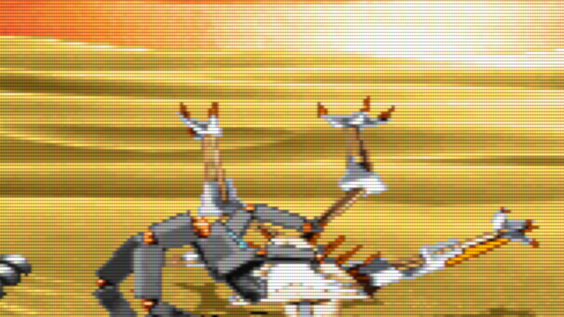<br>The desert arena through the CRT filter (1:1 crop) |
| 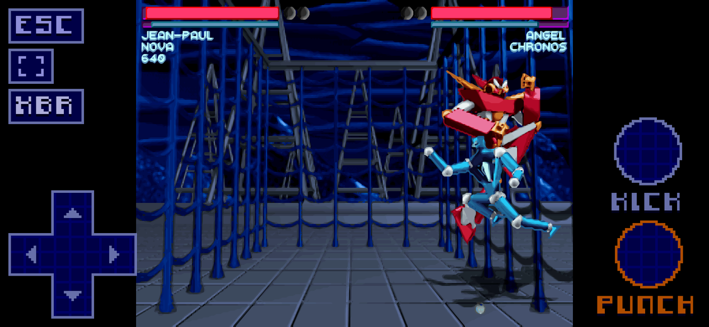<br>Phone: Nova in the cage arena, controls in the side bands | 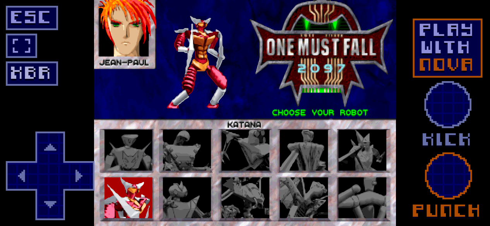<br>Phone: **PLAY WITH NOVA** on the robot screen |
| 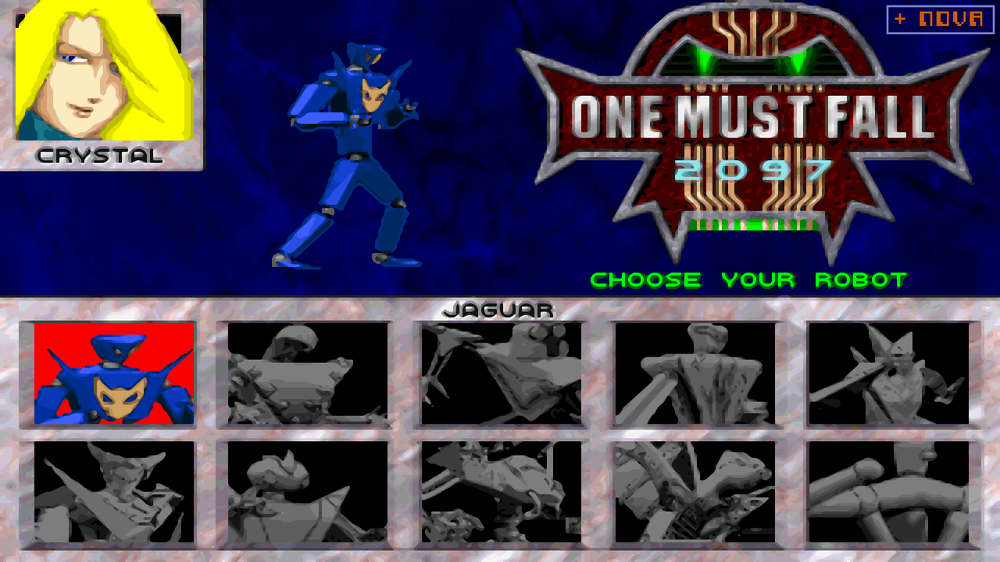<br>Desktop: the **+ NOVA** tile, top right | <br>Trash talk before the fight |
| 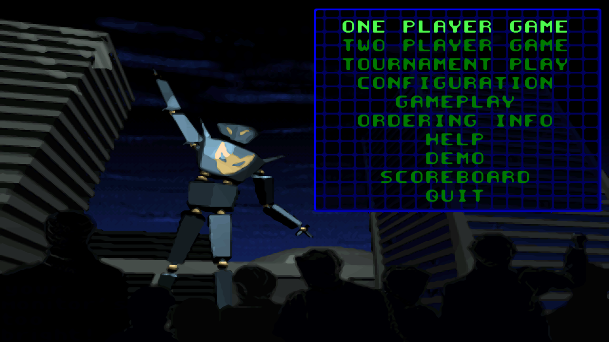<br>Main menu | 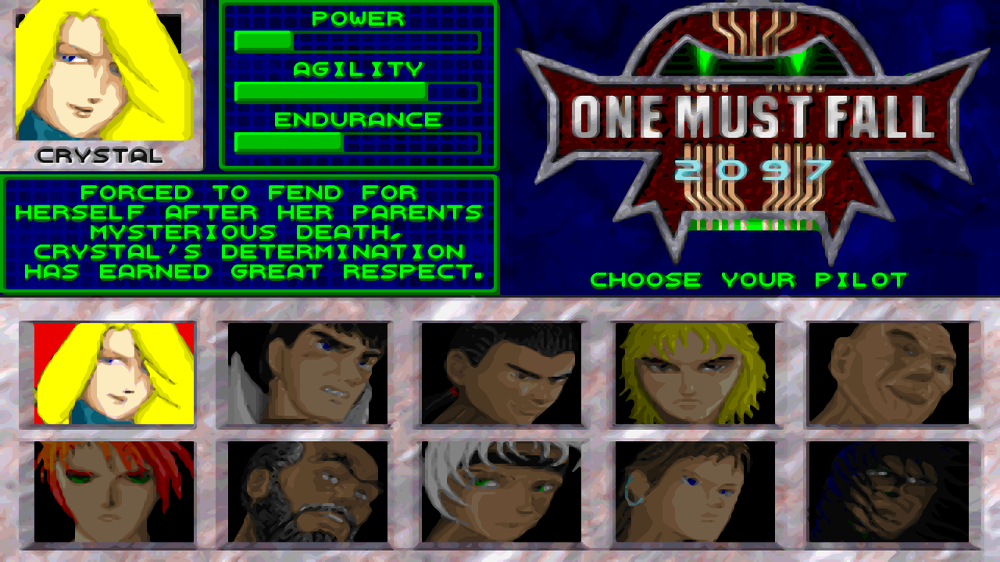<br>Ten pilots to choose from |

## Quick start

```bash
git clone https://github.com/mich-de/omf2097.git
cd omf2097
python3 -m http.server 8734
```

Open **http://127.0.0.1:8734/** and pick **Regular Game**. Add `?touch=1` to the address to try the mobile controls on a computer. `npm install` is only needed for the Node tools below.

## Highlights

- **One page for desktop and mobile.** Touch screens get an on-screen pad and buttons; keyboards just work.
- **A launcher made of the game's own art.** Background, lettering and panels come from the 1994 NetArena screens shipped with the game.
- **Tuned settings.** 50% game speed, Gravis Ultrasound stereo sound, full emulated CPU.
- **Smooth or retro picture.** An xBR shader redraws the 320x200 pixel art with smooth edges on the GPU, and a CRT look is one key further. On by default on phones; on desktop, one key away.
- **Nova in one tap.** The secret robot, without memorising the cheat, with any pilot.
- **A pad made for fighting.** Diagonals that hold steady, and special moves that don't break mid-motion.
- **Headless test kit.** Boot DOS programs from Node, inject keys, capture every new frame, patch files in memory, drive real Chrome over the DevTools Protocol.

## How it was brought back to life

1. **The black screen that wasn't the game.** Headless runs showed a black screen and millions of CPU divide-by-zero faults. The real culprit: Node's `fs.readFileSync` returns small files as views on a shared memory pool, and the emulator copied the whole pool onto the DOS disk. 40 of 98 files arrived as the same 65,600-byte blob, so `OMF.EXE` was running other files' bytes. The fix: give the emulator its own `Uint8Array` copy of each file. `probe_fs.js` now checks this before any test.
2. **"Please run SETUP.EXE".** With intact files the game started, then quit straight away. The SoundBlaster driver `MDRV004R.MUS` from the installer had no card settings in it. Swapping in a configured copy (port 220, IRQ 7, DMA 1) fixed it.
3. **Reading the launcher.** [REA](https://github.com/morluto/rea) with Ghidra 12.1.4 decompiled `OMF.EXE`, a 16-bit Turbo Pascal launcher. It contains no divide instruction that could fault at that point, which moved the investigation from the code to the bytes actually being loaded.
4. **From Node to a real browser.** `cdp_shot.js` drives headless Chrome through the DevTools Protocol with Node's built-in `WebSocket`, no Puppeteer needed: load the page, click, wait, screenshot.
5. **16:9 done right.** `4/3` keeps the original proportions with black side bars. `16/9` fills the window only when it is exactly 16:9. `Fit` always fills. The arena backgrounds are fixed 1994 renders, so there is no hidden field of view to reveal at the sides; that is also why an engine remake such as OpenOMF would not show more of the arena.
6. **A launcher in the game's own style.** The page uses `NETMEGA.PCX` as its background, draws its lettering pixel by pixel with the `NETFONT1.PCX` bitmap font and the original colours, and builds its info panels on the `NETSET.PCX` blue grid. It stays up through the DOS boot text and hands over when the game switches to graphics.
7. **Touch controls that speak the game's language.** The pad and buttons send the keys player 1 is bound to in `SETUP.CFG`: the arrows, `Enter` to punch, `Right Shift` to kick. A diagonal holds two arrows, as on a keyboard, so rolling the thumb from down to down-back only adds back and never passes through neutral mid-move. The down diagonals (crouch block, quarter circles) get wider sectors, and each direction holds until the thumb is 10° past its edge, so a wobbling thumb doesn't flicker between two directions. On touch screens the game keeps 4:3 so the controls sit in the side bands.
8. **Settings at their best.** Game speed now defaults to 50% (`SETUP.CFG` byte 0; 100% was far too fast). Sound moved from a mono Sound Blaster setup that clipped to Gravis Ultrasound stereo, configured with the game's own `SETUP.EXE`. The emulator runs at `cycles=max`.
9. **Nova without the cheat.** The robot grid has ten fixed slots and Nova has none: the only way in is the original cheat (visit all ten slots, press Down 11+ times on Katana, pick Flail). The page recognises the robot screen from the frame, and the NOVA tile replays the cheat, reading the cursor from the screen after every key so it works from any starting position.
10. **Smoother than in 1994.** Higher-resolution textures don't exist: the game draws a fixed 320x200, 256-colour frame. So the page filters the picture instead. The bundle switches off DOSBox-X's scaler, aspect correction and line doubling (`scaler=none`, `aspect=false`, `doublescan=false`), so the page receives the game's real 320x200 frame. For XBR and CRT, a WebGL2 pass then draws it on a canvas laid over js-dos's own: Hyllian's xBR-lv2 (MIT licence, adapted to read its neighbours with `texelFetch`) or a CRT shader. With OFF, js-dos draws the frame itself as before. xBR is the default on touch screens only. On desktop, drawing the full window cost the emulator up to a third of its speed in Firefox, so there the filter starts off. Without a GPU (software WebGL) the filters are not offered at all: the shaders would take CPU from the emulator, and OMF crashes with a runtime error when that happens.
11. **Updates that actually arrive.** js-dos keeps every downloaded bundle in the browser's private storage (OPFS) and never checks it again, so returning players kept playing an old copy. The page asks the server for the bundle's ETag and loads `omf2097.jsdos?v=<ETag>`, a new cache entry after every deploy, and deletes the older copies.
12. **Quitting returns home.** DOSBox-X reports text mode as 720 pixels wide. Once the game has started, more than 1.5 s of text mode means it quit to DOS (its order screen and the prompt), so the page reloads to the launcher.
13. **Full screen, the right way round.** On phones, starting the game asks for full screen and locks landscape; a button under ESC toggles it later. On desktop the full screen and filter buttons sit top left and fade out when the mouse stops moving.
14. **Nova with every pilot.** The chosen robot's portrait takes the pilot's colours, and some schemes are dull: with Christian its saturation is only 28–35, so the tile never showed, and with other pilots it blinked. The page now leans on the other nine portraits instead: no colour at all, and on average neither black nor white, which also keeps fades, dark menus and the intro's white flashes out. Checked with all ten pilots.

## Built with

| What | Used for |
|---|---|
| [js-dos](https://js-dos.com/) 8.5.3 (emulators 8.5.2) | The player, its bundle cache, and the CommandInterface: keys, frames, screenshots, emulator stats |
| DOSBox-X, compiled to WebAssembly | The emulated PC: Gravis Ultrasound, `cycles=max`, native 320x200 output |
| WebGL2 | Hyllian's xBR-lv2 ([libretro/glsl-shaders](https://github.com/libretro/glsl-shaders), MIT) and a CRT shader with scanlines and an aperture-grille mask |
| GitHub Pages | Hosting, straight from the root of this repo |
| [OpenOMF](https://github.com/omf2097/openomf) sources | The `SETUP.CFG` layout (`src/formats/setup.h`) and how the Nova cheat works (`melee.c`) |
| [REA](https://github.com/morluto/rea) + Ghidra 12.1.4 | Decompiling the `OMF.EXE` launcher |
| Chrome DevTools Protocol, over Node's built-in `WebSocket` | Headless Chrome tests: keys, touches, screenshots, network logs, performance |
| WebDriver BiDi | The same measurements in headless Firefox |
| ImageMagick, Python `zipfile` | Screenshots and comparisons; patching `dosbox.conf` inside the bundle |
| [fontTools](https://github.com/fonttools/fonttools) | Turning the game's bitmap fonts into TTF and WOFF2 |

## The game's fonts, as real font files

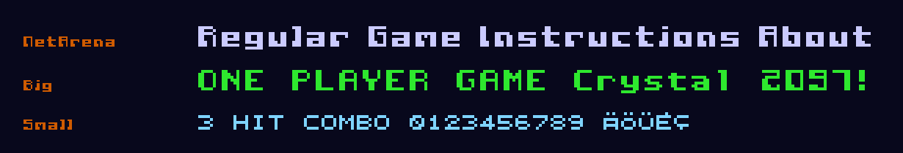

The game's bitmap fonts, converted to TTF and WOFF2 in [`assets/fonts/`](assets/fonts/). Each pixel is a square outline, so they stay crisp at their cell size and whole multiples of it.

| Font | From | Cell | Characters |
|---|---|---|---|
| **OMF 2097 NetArena** | `NETFONT1.PCX`, the NetArena lettering of the launcher | 9 px, proportional | ASCII |
| **OMF 2097 Big** | `GRAPHCHR.DAT`, the game's menu and HUD font | 8x8 px | ASCII + code page 437 letters and symbols |
| **OMF 2097 Small** | `CHARSMAL.DAT`, the game's small font | 6x6 px | ASCII (capitals only) + code page 437 letters |

```css
@font-face { font-family: "OMF 2097 Big"; src: url(assets/fonts/omf2097-big.woff2) format("woff2"); }
h1 { font: 32px "OMF 2097 Big"; } /* 4 x 8 px: every pixel lands on whole screen pixels */
```

Rebuild them with `pip install fonttools brotli`, then `python3 tools/build_fonts.py`.

## How it was tested

- **Real GPU and no GPU.** Headless Chrome on the laptop's Intel GPU (`--use-angle=gl`) and on software WebGL (SwiftShader), plus headless Firefox over WebDriver BiDi.
- **Straight to the emulator.** A script hooks `window.Dos` before the page loads to reach js-dos's CommandInterface. It sends keys to the emulator, grabs native 320x200 frames, and reads `asyncifyStats()` (cycles per millisecond) to compare emulator speed with and without the filters.
- **An opponent that stands still.** Moves and diagonals were checked in a TWO PLAYER GAME, where player 2 never touches a key.
- **Menus that skip.** The game's menus sometimes take one key press twice, so scripts read the highlighted line from the frame (the brightest one) and correct the cursor before confirming.
- **Thumbs.** Touch events on an emulated phone, with a log of every key the pad sends while a finger sweeps around it.

## Behind the scenes

| | |
|:---:|:---:|
| 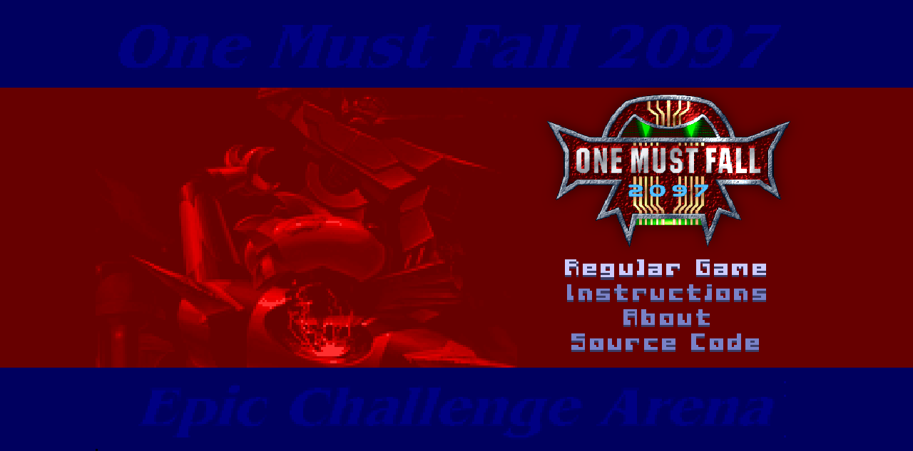<br>Launcher on desktop | 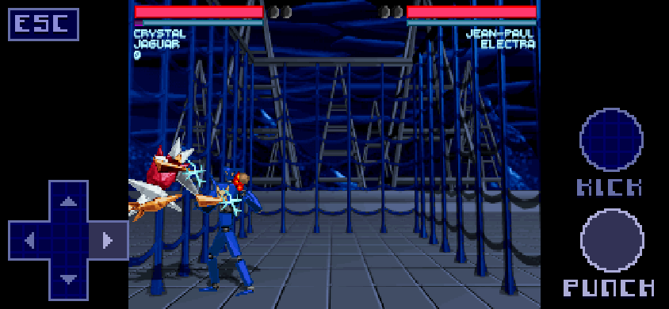<br>First version of the phone controls |
| 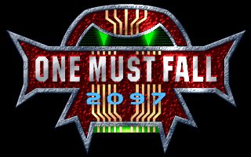<br>Title screen, headless Node run | 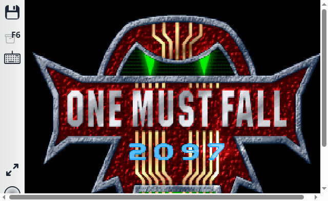<br>js-dos player in Chrome |
| 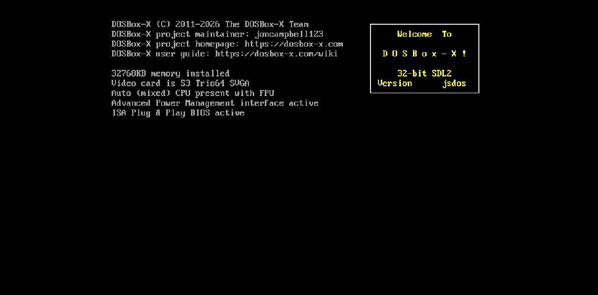<br>`renderAspect: "4/3"`: side bars, no distortion | 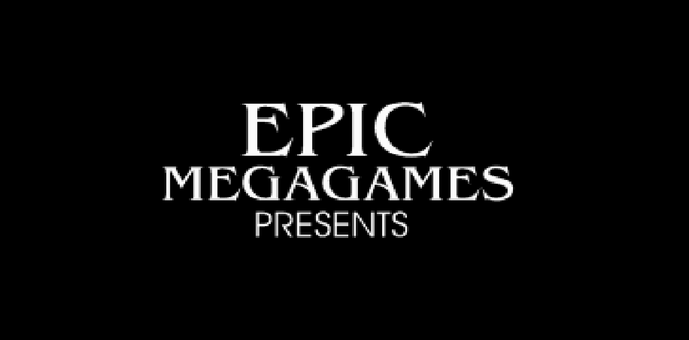<br>`renderAspect: "16/9"`: stretched |
| 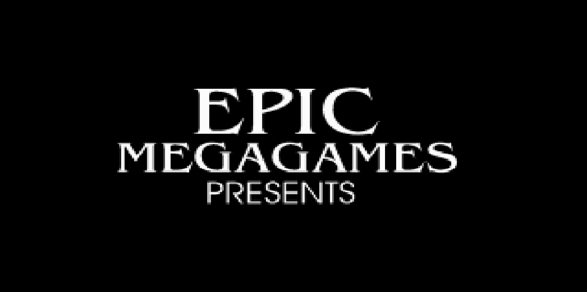<br>`renderAspect: "Fit"`: always fills | 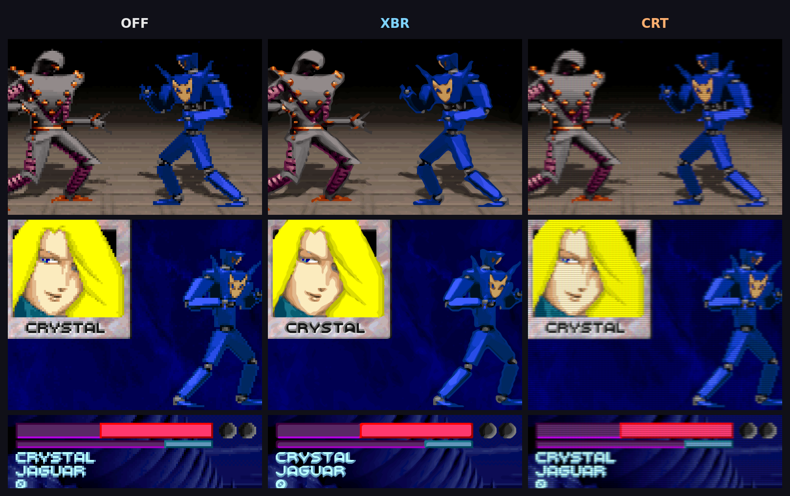<br>Picture filters: OFF, XBR, CRT |

## Game settings

| Setting | Value | Where |
|---|---|---|
| Game speed | 50% | `SETUP.CFG` byte 0 (`game_speed`, 0-10) |
| Sound | Gravis Ultrasound, stereo (240 / IRQ 5 / DMA 3) | `SOUNDCRD.INF`, `MDRV003R.MUS`, `gus=true` in `dosbox.conf` |
| Emulated CPU | `cycles=max` | `dosbox.conf` and `jsdos.json` in the bundle |
| Video | Shadows high, animations, palette animation and screen shakes on | Game defaults, already the maximum |
| Video output | The game's own 320x200 frame (`scaler=none`, `aspect=false`, `doublescan=false`) | `dosbox.conf` in the bundle |
| Picture filter | xBR on phones and tablets, off on desktop (`F9` cycles OFF, XBR, CRT) | `index.html`, WebGL2 |

## What's in the repo

| Path | What it is |
|---|---|
| `index.html` | The game page: launcher, js-dos player, touch controls, picture filters, NOVA tile |
| `js-dos/` | js-dos 8.5 player and the DOSBox-X WebAssembly build served with the page |
| `assets/` | Launcher art taken from the game (`NETMEGA.PCX` background, logo) |
| `assets/fonts/` | The game's three bitmap fonts as TTF and WOFF2, plus a specimen |
| `tools/build_fonts.py` | Builds those fonts from the game files |
| `omf2097.jsdos` | Ready-to-run bundle: game files plus DOSBox config |
| `installed_game/` | Installed, configured game |
| `extracted/` | Original CD contents: installer and manuals |
| `omf_clean_test/`, `*.zip`, `*.iso` | Source archives and a pre-installed reference copy |
| `screenshots/` | Gameplay shots and the development screenshots shown above |
| `browser_test.html` | Minimal test page used during development (needs `npm install`) |
| `probe.js` | Headless DOSBox runner: frame capture, key injection, in-memory file patches |
| `probe_fs.js` | Checks that the emulator sees byte-identical files |
| `cdp_shot.js` | Drives Chrome over CDP: load, wait, click, screenshot, evaluate |
| `test_*.js`, `run_setup_gen.js` | Earlier install and setup experiments |

## Tools

```bash
npm install

# Does the emulator see your files intact?
node probe_fs.js installed_game

# Boot something headless and save every new frame to screenshots/
node probe.js dosbox "OMF.EXE" 30 mytag
# env: DIR=  BUNDLE=<file.jsdos>  KEYS="sec:keycode,..."  STEP_MS=
#      OVERRIDE="FILE=path"  EXCLUDE="FILE,..."  PATCH="FILE@offset:hexbytes"

# Screenshot the page in real Chrome
google-chrome-stable --headless=new --remote-debugging-port=9333 --remote-allow-origins='*' --window-size=1280,720 about:blank &
node cdp_shot.js "http://127.0.0.1:8734/" 20000 out.png [x,y] [waitAfterClickMs]
```

## Display options

`index.html` passes these to js-dos v8's `Dos()`:

| Option | Value | Effect |
|---|---|---|
| `autoStart` | `true` | Boots as soon as **Regular Game** is picked, no play button |
| `kiosk` | `true` | Hides the js-dos sidebar |
| `renderAspect` | `"Fit"` on desktop, `"4/3"` on touch | Desktop fills the window; on touch screens 4:3 leaves side bands for the controls |
| touch mode | `(pointer: coarse)` | Detected automatically; `?touch=1` forces it on, `?touch=0` off |
| picture filter | `xbr` on touch, `off` on desktop | XBR and CRT are drawn by the page on the GPU, OFF by js-dos; `F9` or the button cycles them, and the choice is kept in `localStorage` |

Other `renderAspect` values: `"AsIs"`, `"16/9"`, `"16/10"`, `"5/4"`, `"1/1"`.
